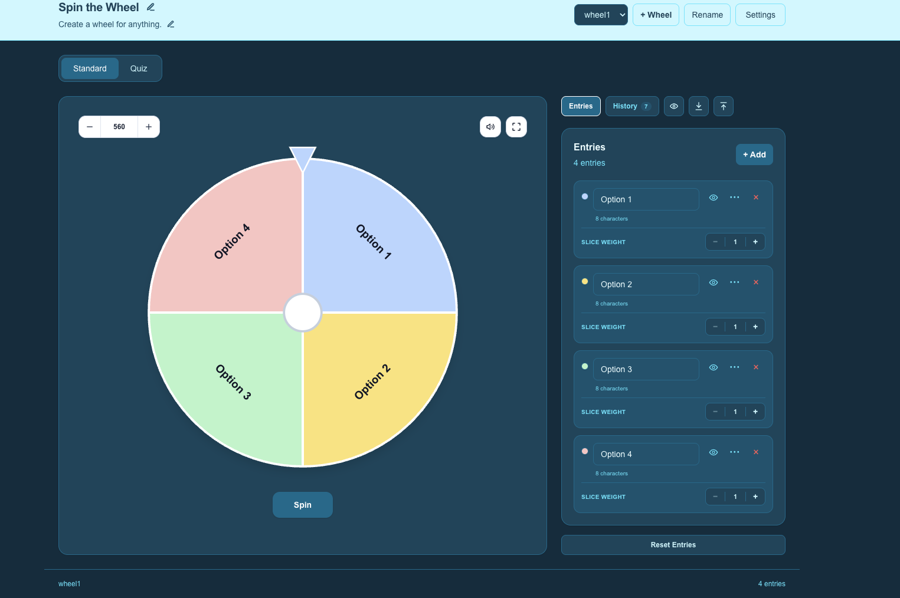
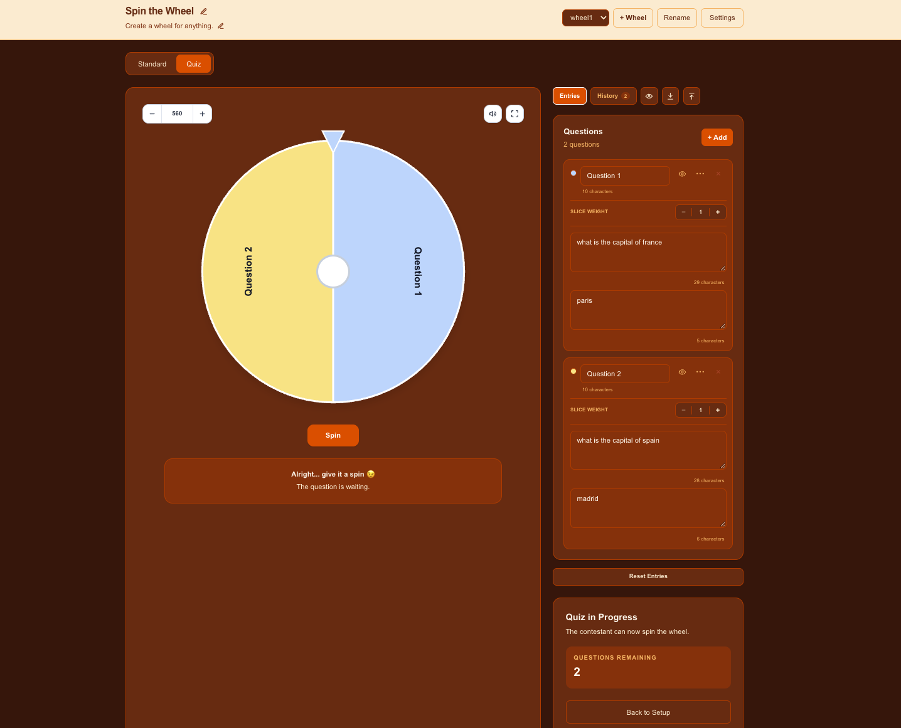

# Spin the Wheel

A customizable wheel application for random selections, quizzes, and everyday decision-making.

Built with **Next.js**, **React**, **TypeScript**, and **Tailwind CSS**.

## Screenshots

### Standard Mode



### Quiz Mode



## Features

### 🎡 Wheel Builder

- Create and manage multiple wheels
- Add, edit, duplicate, hide, and remove entries
- Customize wheel titles and descriptions
- Adjust slice weights for weighted selections
- Give any entry an optional emoji from the entry menu, with a skin-tone row for people and hand emoji
- From 40 entries the wheel shows emoji-only slices instead of hiding every label
- Change wheel size and spin settings
- Rename or delete wheels from the main interface

### 🎯 Standard Mode

Use the wheel for anything that needs a random selection:

- Decisions
- Names
- Activities
- Games
- Lists
- Custom choices

### 🧠 Quiz Mode

Create interactive question-and-answer quizzes directly on the wheel.

- Add questions and answers to each entry
- Questions remain hidden until the wheel finishes spinning
- Reveal answers with the **Show Answer** button
- Progress through questions one spin at a time
- Keep quiz history separate from standard spin history

### 🎨 Appearance and Controls

- Multiple appearance themes
- Responsive interface
- Adjustable wheel size
- Configurable spin speed and duration
- Optional sound controls
- Slice visibility controls
- Import and export wheel data as JSON
- Share the app from the header: the share sheet on phones, or a copied link elsewhere.
- Send feedback from Settings without a GitHub account, or report on GitHub

### 📜 History

Completed spins can be recorded with:

- Selected entry
- Mode
- Question, when applicable
- Timestamp

## Tech Stack

- **Next.js 16**
- **React 19**
- **TypeScript**
- **Tailwind CSS 4**
- **ESLint**
- **Turbopack**

## Getting Started

### Clone the repository

```bash
git clone https://github.com/Franklindot04/spin-the-wheel.git
cd spin-the-wheel
```

### Install dependencies

```bash
npm install
```

### Start the development server

```bash
npm run dev
```

Open the application at [http://localhost:3000](http://localhost:3000).

## Production Build

Run linting and create an optimized production build:

```bash
npm run lint
npm run build
```

Start the production server:

```bash
npm run start
```

## Data

Wheel configurations and spin history are stored locally in the browser.

Wheel data is never sent to a server or shared with anyone. The only thing the app sends is a feedback report, and only when someone submits the Send feedback form. Data stays in your browser on your device, so clearing your browser data removes it. Export your wheels regularly to keep a copy. Spin history keeps the newest 500 spins per mode for each wheel.

If saved data cannot be read, the app keeps a copy of the original in your browser and offers to export it.

The application also supports exporting and importing wheel data as JSON. This makes it possible to back up wheel configurations, restore them later, or move them between browsers and environments.

## Project Status

This project is under active development.

The current release establishes the core foundation for:

- Wheel builder and entry management
- Multi-wheel management
- Standard random-selection mode
- Quiz mode
- Appearance themes and settings
- Spin and quiz history
- Local browser persistence
- JSON data import and export

Further improvements and refinements are planned for future releases.

## Feedback and Issues

To report a bug or ask for a feature, you can either:

- Use **Send feedback** in Settings. It needs no GitHub account.
- [Open an issue](https://github.com/Franklindot04/spin-the-wheel/issues/new/choose) on GitHub and pick the matching form, or use **Report on GitHub** in Settings.

## Running the feedback form

This part is for the site owner. The Send feedback form in Settings posts to a Cloudflare Pages Function (`functions/api/feedback.js`), which stores each report in a D1 database. The Function does not run under `npm run dev`. There a stand-in answers instead, and nothing is sent or stored.

### What it needs

- A Cloudflare Pages project connected to this repository. A Direct Upload project does not run Functions.
- A D1 database named `feedback`, with a binding named `DB` in the Pages project settings (add it for Production and Preview, then redeploy).
- A Turnstile widget that lists the site's hostname. Its secret key goes in the Pages project settings as a secret named `TURNSTILE_SECRET_KEY`, set before the deployment that uses it.
- The widget's public sitekey in `app/lib/turnstile.ts`. A build on Cloudflare Pages stops if that file still has Cloudflare's test sitekey.

Keep keys, secrets and tokens out of the repository. Only the public sitekey belongs in it.

### Create the table

Run this once in the D1 console (it is the same as `migrations/0001_feedback.sql`):

```sql
CREATE TABLE IF NOT EXISTS reports (
  id TEXT PRIMARY KEY,
  created_at TEXT NOT NULL DEFAULT (datetime('now')),
  what_happened TEXT NOT NULL,
  what_i_did TEXT NOT NULL DEFAULT '',
  what_i_expected TEXT NOT NULL DEFAULT '',
  device TEXT NOT NULL DEFAULT '',
  email TEXT NOT NULL DEFAULT '',
  version TEXT NOT NULL
);

CREATE INDEX IF NOT EXISTS idx_reports_created_at ON reports (created_at);
```

### Read reports

In the D1 console, the newest 20 reports:

```sql
SELECT id, created_at, what_happened, version FROM reports ORDER BY created_at DESC LIMIT 20;
```

Add `what_i_did`, `what_i_expected`, `device` and `email` to the column list to see the rest of a report.

### Delete old reports

Nothing deletes reports on its own. Run this by hand to remove reports older than 180 days:

```sql
DELETE FROM reports WHERE created_at < datetime('now', '-180 days');
```

### What is kept

A report holds only what the person types, including the email if they add one, and the app version. Reports are kept for up to 6 months and are deleted by hand with the query above.

## License

This project is licensed under the [MIT License](./LICENSE).